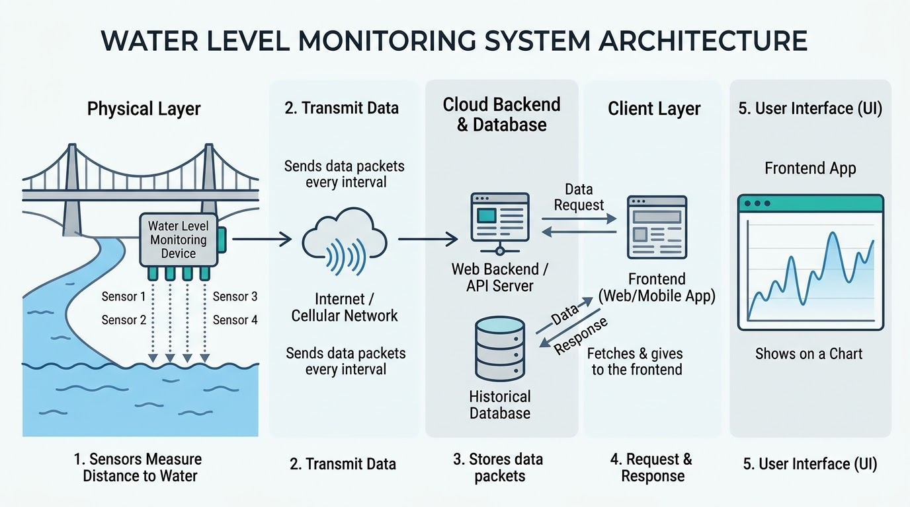

## SURGE - Real-Time Flood Warning System 🌊


An end-to-end IoT and Web solution engineered to bridge remote river level monitoring sensors directly to an interactive, real-time web dashboard.

The system continuously measures water clearance height at river locations using arrayed ultrasonic sensors, transmits telemetry payloads over Wi-Fi, stores historical time-series data, and visualizes real-time threat levels with interactive geographic maps and graphs.

## System Overview



## Usage (Frontend)

- Clone the repo:

```bash
git clone https://github.com/WimansaHansanee/SURGE-WebFrontend.git
```

- Install dependencies:

```bash
npm install
```

- Run:

```bash
npm run dev
```

> The backend is published [here](https://github.com/WimansaHansanee/SURGE-WebBackend).
